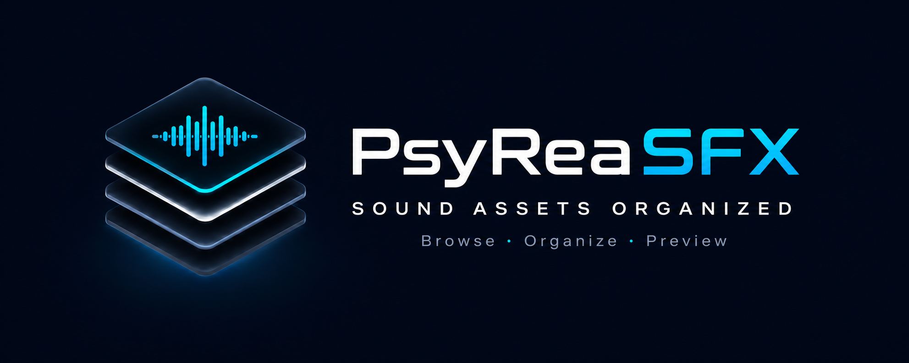

<p align="center">
  <a href="https://github.com/Psysia/PsyReaSFX">
    
  </a>
</p>

# PsyReaWwise WebView

[English](README.md) · **简体中文**

在 REAPER 编辑 Wwise 音频，再把对应区间的渲染结果批量回写到 Wwise Originals。可以预览配对和矩阵取轨，选择 REAPER 渲染预设，并把同一份 WAV 同步到 REAPER 工程的 `Samples`。

[0.2.0 Beta 2 发布说明](https://github.com/Psysia/PsyReaSFX/releases/tag/psyreawwise-v0.2.0-beta2) · [Windows x64 离线包](https://github.com/Psysia/PsyReaSFX/releases/download/psyreawwise-v0.2.0-beta2/PsyReaWwise-WebView-0.2.0-beta2-win64.zip) · [PsyReaSFX（PRS）](https://github.com/Psysia/PsyReaSFX)

## 安装

**环境要求** Windows x64、支持区间选择 API 的 REAPER 7（已验证 7.86），以及提供 WAAPI 的 ReaWwise 1.0.4 或更新版。在 Wwise 的 User Preferences 启用 WAAPI 并打开工程。PRW 默认连接 `127.0.0.1:8080`。 [ReaWwise](https://github.com/audiokinetic/ReaWwise)

1. 在 REAPER 里打开 **扩展 → ReaPack → 导入仓库**，添加下面的 PRS 订阅。已经订阅 PRS 时从第 2 步开始。

   ```text
   https://raw.githubusercontent.com/Psysia/PsyReaSFX/main/index.xml
   ```

2. 执行 **同步软件包**，安装 **PsyReaWwise WebView**。面板和 ReaWebAPI 运行时随包提供。
3. 从 Action List 运行 `PsyReaWwise_WebView.lua`。已加载兼容的 ReaWebAPI 时直接复用。首次安装时，动作会准备运行时并提示重启一次 REAPER。

离线安装时，解压完整 ZIP，在 **Action List → New action → Load ReaScript** 中加载 `PsyReaWwise_WebView.lua`。0.1.0 仍可作为独立包安装。 [0.1.0 发布页](https://github.com/Psysia/PsyReaSFX/releases/tag/psyreawwise-v0.1.0)

## 批量替换 Wwise WAV

1. **选中音频。** 在 REAPER 多选区间，在 Wwise Media Pool 多选目标 WAV，也可以选对应的音源或 Sound。使用区间渲染矩阵时，为每个要配对的区间勾选一个输出，可以是轨道或主轨。
2. **预览配对。** 进入 **传输到 Wwise → 预览传输**。两边唯一同名的条目自动连线，匹配时忽略大小写和 `.wav` 后缀。依次点区间和 WAV 可以手动配对。REAPER 节点显示渲染轨，Wwise 节点显示 Originals 目录。
3. **核对渲染设置。** 展开 **渲染设置**，可选择在 REAPER 中以 **所有设置** 保存的预设并查看采样率、声道、WAV 位深、标准化、限制器、淡入淡出和尾音。选中的区间和矩阵决定渲染源与范围。
4. **渲染并替换。** Wwise 原文件名和音源 GUID 会保留。回写核验成功后，REAPER 区间名采用目标 WAV 去掉扩展名后的名称。同一批区间改名可在 REAPER 一次撤销。

**同步到 Samples** 默认勾选。同一份 WAV 会写到当前 `.rpp` 同级的 `Samples`，也可以选用已有导出目录。预览会标明哪份 Samples 副本将新增或替换。

### 预设与输出

选择包含一个 WAV 输出的预设用于 Wwise 替换。第二输出格式会渲染到暂存目录。PRW 默认设置沿用目标 WAV 的采样率和声道数。加载 SWS 时，还可应用预设中的渲染速度、重采样模式和内部工程采样率选项。批量渲染结束后，PRW 会恢复原渲染设置和区间选择。

## 其他工作流

| 操作 | 在 PsyReaWwise 中 |
| --- | --- |
| 取回 Wwise 音源 | 在 **导入到 REAPER** 读取 Wwise 选中项并导入工作副本。也可以同时创建区间，或将已有素材、区间绑定到一个 Wwise 音源。 |
| 回写已绑定的素材或区间 | 在 **更新现有音源** 选中绑定项，预览目标后回写。区间会使用已配置的矩阵输出。 |
| 使用 REAPER 当前渲染范围传输 | REAPER 没有选中区间时，选一个 Wwise 音源、Sound 或容器作为参照。预览 **Wwise 同级 / 容器内** 或 **Wwise 上一级**，确认后渲染传输。 |

暂存渲染和备份保存在 REAPER 媒体目录下的 `PsyReaWwise/Transfers`。完成后面板会显示已核验的 Wwise 文件数和已同步的 Samples 文件数。

## 搭配 PsyReaSFX 使用

**PsyReaSFX（PRS）** 是 REAPER 里的本地音效库工作区，支持波形试听、UCS 浏览和相似音色检索。先用 PRS 找声音、试听和入轨，再用 PsyReaWwise 把做好的声音送回 Wwise。两个工具都可以通过同一个 PRS ReaPack 订阅安装。 [查看 PsyReaSFX 与 REAPER 工具集](https://github.com/Psysia/PsyReaSFX)

## 运行时与验证

PsyReaWwise 使用 PRS 黑色配色，并读取 PRS 保存的界面语言。没有 PRS 语言设置时，使用 Windows 显示语言。

随包提供的 ReaWebAPI 0.3.9.30-prs.3 采用 LGPL-3.0-or-later，包含匹配源码和许可证声明。 [运行时锁定清单](runtime/reawebapi/runtime-lock.json) · [ReaWebAPI](https://github.com/Psysia/ReaWebAPI)

双语面板通过了无界面 Chromium 测试，Wwise 回写经 WwiseConsole 验证。隔离 REAPER 7.86 测试验证了三个重叠区间的逐轨输出、预设格式和峰值标准化。原生停靠待实机验收。
